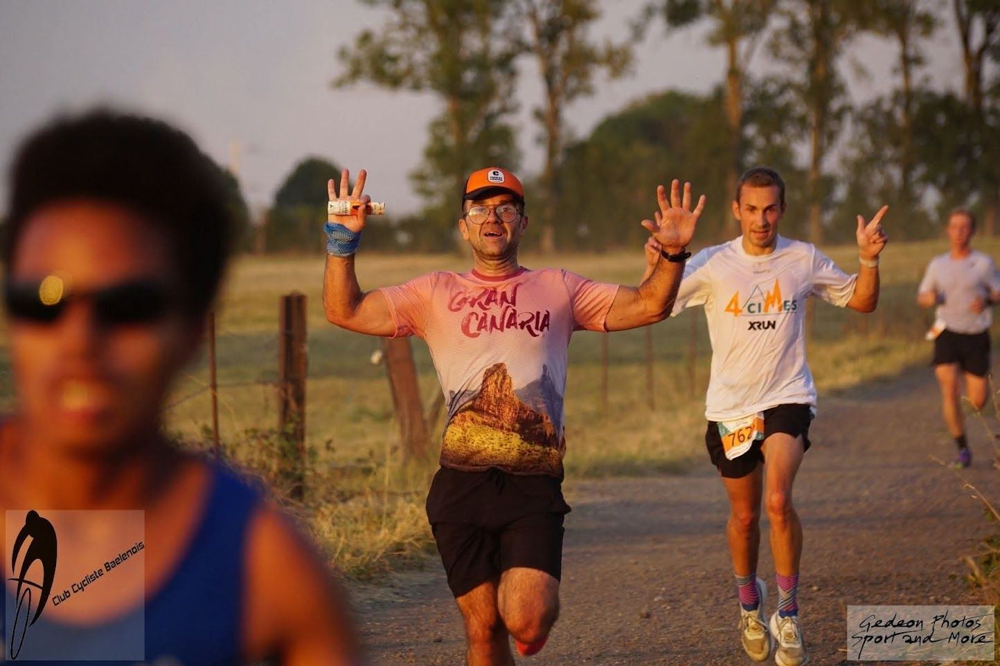

Pour rependre une intro que j'ai plus ou moins déjà utilisée: 

> À l'heure où l'IA est partout, il est encore plus important d'écrire soi-même, sans aide, surtout si ce sont des choses sans importance.

Et quoi de plus futile qu'un récit de course de village?

Le Jogging de Baelen est une course parmi tellement d'autres, c'est-à-dire qu'elle n'a l'air de rien avec ses 7.8 km, mais les paysages et l'ambiance font que ça constitue une très belle expérience. A priori j'étais loin d'être chaud pour y participer: une course un vendredi soir, moins de 10 km, pas vraiment le meilleur plan. Mais il y avait quand même un problème dans l'histoire: j'avais participé l'[année dernière](https://www.strava.com/activities/15474529907), et j'avais fait un très mauvais temps (`0:34:50`), suite à des problèmes digestifs (triste mais ça arrive parfois).

Dans ma tête il fallait réparer ça et faire une course décente, voire mieux si les jambes le permetait. Pour ajouter une touche de surréalisme (je ne trouve pas le bon terme), un incendie s'était déclaré quelques heures auparavant, à une dizaine de kilomètres d'où on se trouvait. Certes, aucun risque pour nous, mais je ne pouvais m'empêcher de penser à la fameuse photo où on voit deux touristes assis sur un transat en train de regarder l'énorme incendie des Landes. Pareil pour nous: on coure pendant que las Fagnes partent en fumée.

## La course 2025

Ce n'était pas initialement prévu mais comme j'avais raconté la course dans Strava, autant s'en servir.

> J'étais chaud et j'avais chaud, les amis m'avaient motivé à faire la course, première depuis le jogging (championnats du monde) de Verviers, 2° depuis l'opération. Échauffement avec Joël, on dégouline avec cette chaleur mais ça ira.              
Le départ, ça part vite mais ça respire tranquillement, 7 km ça passe vite mais peut faire mal. À la maison déjà un peu mal au ventre mais ça ira mieux une fois dans l'action. C'est ce que je me disais... KM4, ça fait vachement mal, ça part et ça revient. Le temps passe et je doute de plus en plus de ma fin de course. Je vais me ch*** dessus si je ne freine pas.           
6.24 km de course, je jette l'éponge, trop besoin de faire mes besoins...             
Quasi 10 minutes pour faire 1.4 km, mais bon c'était drôle, des trucs qui arrivent (pas souvent), faudra juste que je me venge!

## La course 2026

Échauffement de 3-4 kilomètres, juste ce qu'il faut, et comme toujours, des mauvaises sensations. Heureusement je sais que ça n'influencera pas vraiment ma course, comme si il y avait moyen de passer du mode "warmup" au mode "explosif" en actionnant un interrupteur. Aussi un truc pour lequel ma compagne se foutait un peu moi: j'avais des chaussures différentes pour l'échauffement (Adidas Adios Adizero) et pour la course (Nike Zoom X Streakfly 2). Il n'y a pas si longtemps j'aurais dit que ça ne servait à rien, maintenant je dirais que si: ces chaussures de course sont hyper légères et aggressives, j'ai l'impression que pour la même sensation d'effort, je vais à un km/h plus vite. Probablement exagéré mais si ce n'est qu'une sensation, c'est déjà pas mal.

Le départ se fait comme d'hab: ni bien ni mal placé. Je vois quelques très jeunes devant, ça il faudra être prudent et essayer d'éviter les chutes. Ça part évidemment trop vite, autrement dit je pars trop vite et après quelques hectomètres je me dis déjà:
> Mais qu'est-ce que tu es en train de faire, ça ne va pas aller!

Le parcours monte assez rapidement, je me dis que c'est bon, je vais me faire dépasser, sauf que non, c'est plutôt le contraire qui arrive. Je vois un coureur bien connu un peu devant moi, quand je l'avais vu s'échauffer j'avais penser: c'est lui qui gagne dans notre catégorie d'âge, je le suis avec comme idée: le plus de temps derrière lui, le mieux ce sera... et puis il me larguera. Curieusement ça ne fait pas trop de mal de la suivre, et le dépasser devient presqu'obligatoire. Bon OK c'est provisoire, il reviendra quand j'explose... Autre coureur connu un peu devant, même raisonnement: je tente de le suivre autant que je peux, ça fera déjà progresser. Puis bizarrement, je le dépasse, en montée je crois, truc complètement improbable, mais ça arrive. Comme pour l'autre coureur je me dis: ok dès que j'explose il me largue. 


x
Les kilomètres défilent, il y a beaucoup de monde pour nous encourager, ça fait plaisir! Il reste 2K, je ne regarde pas derrière moi et d'ailleurs je ne regarde pas non plus la montre, à quoi ça servirait, je ne pense pas pouvoir accélérer. Je me rappelle de l'année dernière, où j'avais marché, où j'avais encouragé les amis, où j'avais discuté avec des gens. Là plus le choix, je vais finir. Ça sent vraiment la fin et un des deux que j'ai dépassé se met à ma hauteur et me dépasse (un peu). Je l'encourage, et oui je suis comme ça, et remet une couche vu qu'il ne reste plus grand chose et qu'on est sur du plat. On va vite et ça fait plaisir. Derniers virages, dernière montée, je donne presque tout, pas envie qu'il revienne.

C'est fait, la course catastrophique de l'année dernière est réparée, 7 minutes de mieux et un temps que je ne connais pas, puisque je n'ai vraiment pas regarder la montre. Trois secondes d'avance sur mon poursuivant, que je remercie pour m'avoir obligé à aller un peu plus loin dans l'effort.

## Les conclusions

Pas grand chose à dire, juste que quand une course se passe bien et que les sensations sont bonnes, c'est vraiment une expérience sympa. Aussi comme toujours point de vue entrainements, ça confirme que juste en faisant du volume, sans faire énormément de vitesse, les courses peuvent bien se passer. En gros, je finis à une vitesse moyenne qui me semble assez difficile à maintenir en entrainement.

|  |
|:--:|
| Sur le dernier KM. Photo de [Gédéon](https://www.gedeonbaltazard.be). |
|------------------------------ | 

La prochaine course? Aucune idée, les objectifs de cette années sont beaucoup plus tard, et avec tout le reste, c'est difficile de se focaliser à long terme.