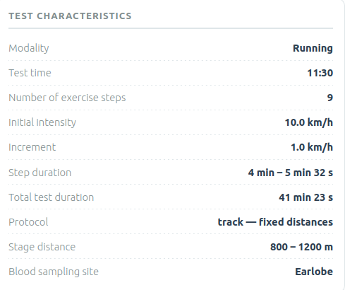
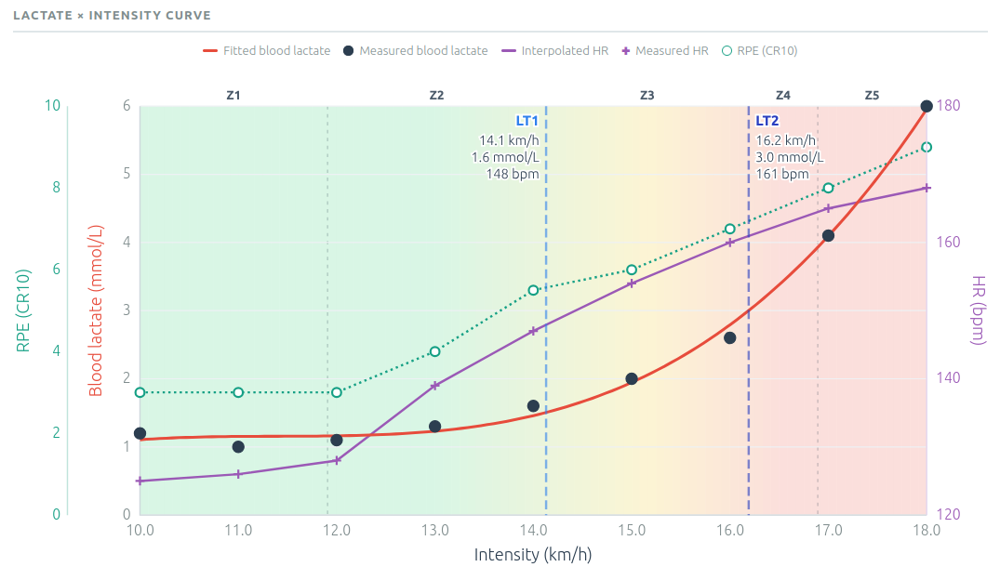
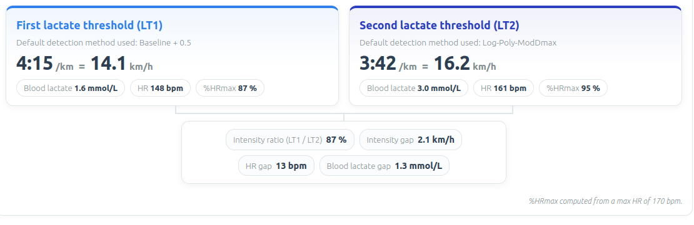
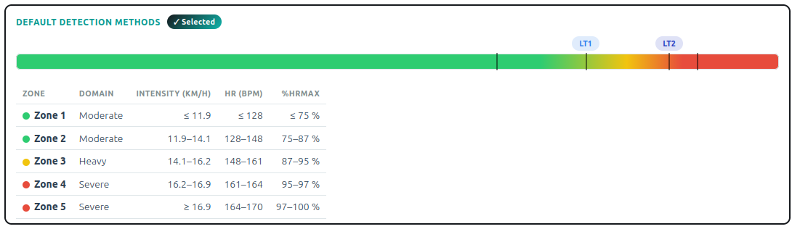
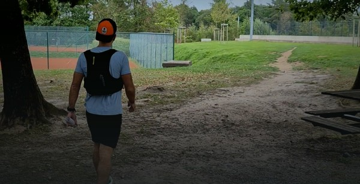

Sur Youtube et sur les réseaux sociaux, on n'en parle tout le temps: le seuil. 
> Il faut courir au seuil.
> J'ai mes jambes plein d'acide lactique après avoir couru au seuil.
> Sur cette course j'étais juste en dessous de mon seuil.

Des exemples qu'on en entend à foison, et pourtant... Il y a beaucoup de choses à dire et redire là dessus. Et le truc c'est que ce n'est certainement pas moi qui vais parler de ça ici, d'abord parce que je n'ai pas le temps, ensuite parce que d'autres l'ont fait et le feront mieux que moi. 

En résumé: il y a plein d'idées reçues dans le monde de la course à pied, parfois même des trucs qui sortent de la bouche des entraineurs, ou même d'athlètes de haut niveau.

Le lactate, on a l'air de penser que c'est un produit dangereux, qui se transforme en acide et "brûle" les muscles, de telle façon qu'on ne peut plus courir à la vitesse espérée. Ce serait utile de comprendre qu'en réalité le lactate peut être considéré comme un carburant, quelque chose que notre organisme doit apprendre à utiliser au mieux si on veut performer.

Mais comme je disais avant, je n'ai pas envie de discuter là dessus, et vous invite donc à lire l'article sur le blog de [Twin Peak](https://www.twinpeaklab.be/fr/blog/lactate-phenix.html). Et si on devait ne garder qu'une ligne de texte:

> Le lactate n'est pas un déchet!

## Le test

Aujourd'hui ce dont on va parler, c'est un test où on va mesurer la concentration de lactate dans le sang, à différents paliers en course à pied. Le protocole est le suivant.
- Une prise de lactate au tout début.
- Un échauffement très lent d'une dizaine de minutes, suivi d'une prise de lactate.
- une série de paliers dont la durée doit être autour de 4 minutes; à l'issue de chacun d'entre eux se fera une nouvelle mesure de lactate.

### En pratique

On souhaiterait avoir une dizaine de points de mesure. Pour ce faire on va commencer par un palier à 10 km/h, et ensuite la vitesse sera augmentée de 1 km/h à chaque palier. Pour les paliers 10, 11 et 12, on réalisera des intervalles de 800 m; à partir du palier 13 (et jusqu'à la fin), ce seront des intervalles de 1200 m. 

L'idée d'avoir des intervalles d'au moins 4 minutes vient du fait qu'il faut atteindre un état stationnaire, où la concentration ne varie quasi plus dans le temps. Avec des intervalles trop courts, l'organisme n'a pas le temps d'arriver à un état d'équilibre. Autrement dit: la concentration en lactacte continuerait d'augmenter, et par conséquent la valeur mesurée serait une sous-estimation. Que ce passerait-il avec des intervalles plus longs, par exemple 8 minutes au lieu de 4? Dans ce cas on serait évidemment plus sûr d'être arrivé à un état d'quilivre; en revanche on accumulerait de plus en plus de fatique, ce qui rendrait plus difficile la réalisation des paliers finaux.

| Palier (km/h) |   Distance (m)    | Temps cible (mm:ss) |
|:-------------:|:-----------------:|:-------------------:|
| 10            | 800               |  4:48              | 
| 11            | 800               |  4:22              | 
| 12            | 800               |  4:00              | 
| 13            | 1200              |  5:32              | 
| 14            | 1200              |  5:09              | 
| 15            | 1200              |  4:48              | 
| 16            | 1200              |  4:30              | 
| 17            | 1200              |  4:14              | 
| 18            | 1200              |  4:00              | 

En pratique il faut pouvoir être assez proche des temps-cibles, ce qui est compliqué pour 2 raisons:
1. Les premiers paliers sont vraiment lent: courir à 10 km/h sur du plat, sur une piste, ce n'est pas si fréquent.
2. Les derniers paliers se font avez déjà pas mal de tours dans les jambes.  

|  |
|:--:|
| _ Caractéristique du protocole pour ce test lactate. © [TwinPeakLab](https://www.twinpeaklab.be/)._ |

## Que tirer du test?

Personnelement je ne suis pas vraiment branché sur ce type de tests, à tort ou à raison. J'en comprends l'utilisé, mais vu qu'au boulot on est sans cesse sur de l'analyse de donnée, mon approche de la course à pied a toujours été de rester la plus empirique possible. Par exemple si faire du volume fonctionne, je ne vais pas me prendre la tête. 

La concentration en lactate pendant l'effort dépend de plein de facteurs, principalement l'intensité de l'effort, mais l'état de fatigue du jour, la possible contamination par un virus ou même l'alimentation jouent aussi un rôle. Donc ici on essaie de mesurer avec une grande précision quelque chose dont on sait que la variabilité est très grande. La solution: faire en sorte de réaliser le test dans des conditions aussi proches que possible d'une fois à l'autre.

Dans ce cas précis j'avais eu une _grosse_ semaine précédente, mais j'avais éviter de courir la veille (mercredi). Et le matin même, j'étais monté (en courant) très calmement.

## Comment ça c'est passé?

Au niveau de la réalisation du test, rien à dire du côté de celui qui me l'a fait passé, Arnaud. Travail très pro, très précis, et ça, ça fait toujours plaisir.

Point de vue sensations: comme prévu, les paliers 10 et 11 sont très pénibles: c'est lent mais malgré tout c'est difficile de les faire dans à l'allure souhaitée. A partir de 12 km/h ça commence à être intéressant, une vitesse facile mais où il est plus facile de fixer l'allure. Ensuite les paliers s'enchainent, entrecoupés de courtes pauses dédiées à la mesure du lactate sanguin, via le lobe de l'oreille. 

Ça commence a réellement devenir compliqué à 17 km/h, vitesse supérieure à celle que j'ai l'habitude de courir sur un 10 km. Bizarrement la transition de 17 à 18 km/h s'est plutôt bien passée, avec une palier couru un rien trop vite je pense. 


À l'issue de celui-ci, je demande à Arnaud si ça vaut la peine de tenter le palier 19 km/h: faisable en théorie, mais ça n'aurait pas vraiment apporté quelque chose point de vue des mesures (en dehors du fait qu'on verrait que le lactate est encore plus haut). Par contre j'en aurais gardé des traces musculairement. Pour ces 2 raisons on décide d'en finir à 18 km/h, on a 9 points de données, suffisament pour faire quelque chose de correct.

## Les résultats

Le but est donc de déterminer les 2 seuiles lactiques, qu'on appelera `LT1`(pour _lactate threshold 1 - 1° seuil lactique_) et `LT2` (2° seuil lactique). C'est qu'il faut savoir c'est qu'il existe de nombreuses formules pour calculer ces valeurs à partir du lactate, et c'est justement cette subtilité qui fait que c'est intéressant de savoir comment l'estimation est faite.

|  |
|:--:|
| _ Courbe de lactate en fonction de l'intensité. © [TwinPeakLab](https://www.twinpeaklab.be/)._ |

Pour `LT1`, on peut par exemple dire que c'est la vitesse à laquelle le lactate atteint une valeur fixée, par exemple 2 mmol/l. Une autre méthode, c'est de voir quand le lactate a augmenté de 0.5 mmol/l par rapport à une valeur de référence, prise au repos par exemple. 

Pour `LT2`, c'est similaire: on peut prendre la vitesse à laquelle le lactate est égal à 4 mmol/l, mais il y a des méthodes un peu moins simple, et qui donnent des valeurs un peu différentes. 

Pour moi au final ça donne ceci:
```python
LT1 = 14.1 km/h
LT2 = 16.2 km/h
```

|  |
|:--:|
| _ Résumé des principaux résultats. © [TwinPeakLab](https://www.twinpeaklab.be/)._ |

## Que faire avec tout ça?

C'est là que ça devient intéressant: on a 2 valeurs, il faut s'en servir. 

### Déterminer ses zones d'intensité

On parle souvent de _courir en Zone 2_, encore faut-il savoir ce que ça veut dire ou, plus concrètement, quel modèle de zones en utilise. Par exemple il existe des divisions en
- 3 zones,
- 5 zones,
- 7 zones...

Ici on illustre avec le modèle en 5 zones avec des intervalles de vitesse et de fréquence cardiaque.  

|  |
|:--:|
| _ Caractéristique du protocole pour ce test lactate. © [TwinPeakLab](https://www.twinpeaklab.be/)._ |

Illustration avec les données de mon test: la Zone 3 correspond à un intervalle entre 14.1 et 16.2 km/h.

### Avoir une estimation du temps sur une course

Il existe pas mal de formules pour estimer l'allure sur marathon en fonction de la veleur de `LT2`. J'en parle plus en détail dans cet article sur le [Marathon d'Anvers](). Mais ça reste à prendre avec beaucoup de précautions.

### Mesurer sa progression

On a parfois tendance à se baser principalement sur une métrique telle que la $\dot{V}0_{2}\max$ pour quantifier des progrès. 

Hors, il peut arriver que 2 coureurs ayant exactement la même valeur pour $\dot{V}0_{2}\max$ réalisent des performances en course bien différentes, par exemple si l'un est capable de maintenir durant un plus long moment un certain pourcentage de sa $\dot{V}0_{2}\max$.

De plus, $\dot{V}0_{2}\max$ atteint rapidement un plateau dans le développement d'un coureur, tandis que `LT1` et `LT2` peuvent encore évoluer pendant 

## Conclusions

Que dire, si ce n'est que les seuils lactiques ont plusieurs avantages sur $\dot{V}0_{2}\max$ en terme de prédiction de la performance et de détermination des zones d'entrainement.

Pour ma part, ça a été le premier test de ce genre, et j'ai l'impression que maintenant que j'ai mis le doigt dans l'engrenage, ce ne sera pas le dernier.


|  |
|:--:|
| _ Chaque coureur est différent. © [TwinPeakLab](https://www.twinpeaklab.be/)._ |


