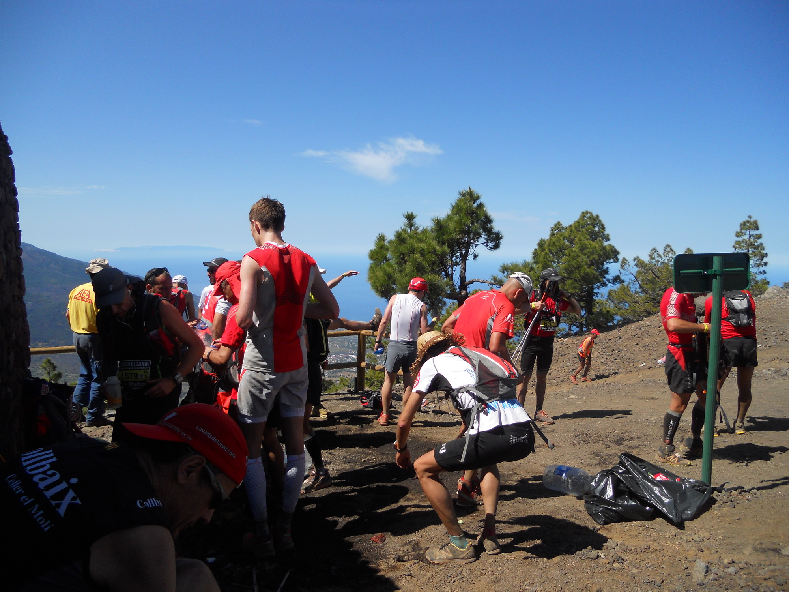
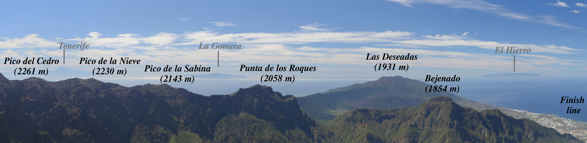
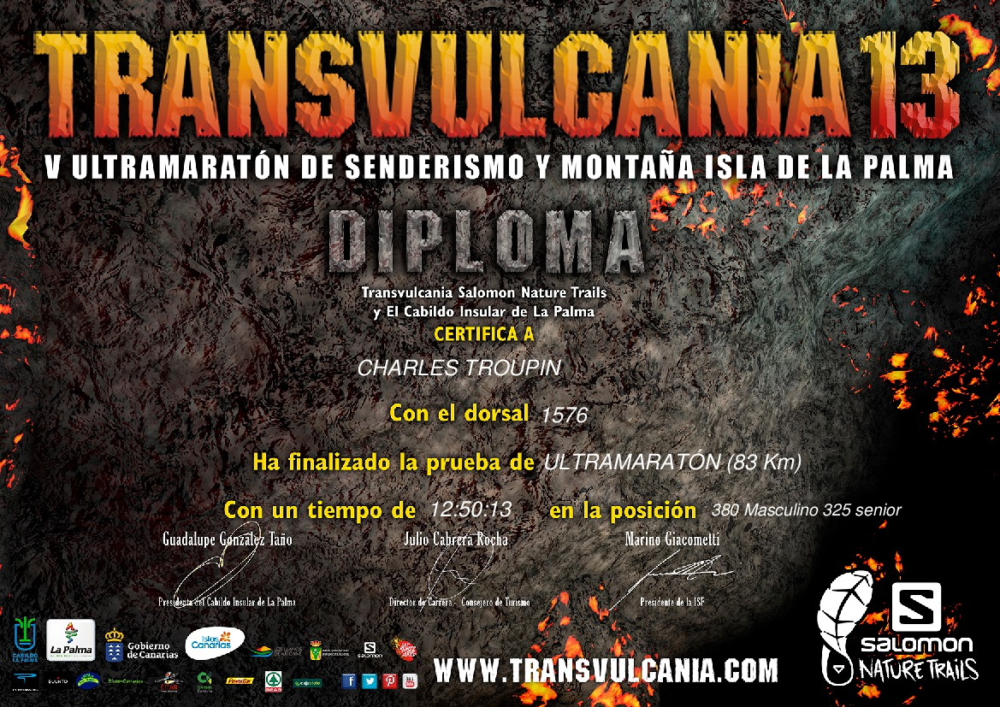

## 7. Punta de los Roques (2040 m)

Pas officiellement un ravitaillement, mais on nous y attendait quand même avec de l'eau. Un des bénévoles au téléphone: “qu'est-ce qui boivent ces gars-là. Tu leur mets des tonneaux de vin et sûr qu'ils te les vident”. A partir de ce point-là, il nous reste environ 400 de D+ jusqu'au sommet. A priori facile, seulement c'est une alternance de montées et de descentes qui nous attend. Pour info, il est possible de passer la nuit dans ce refuge.

|  |
|:--:|
|_Punta de los Roques._|

## 8. Pico de la Nieve (43 km, 2332 m) et Pico de la Cruz (47.5 km, 2351 m)

On est dans la partie “montagne” de la course, et ça fait mal. On voit que les Canariens ont l'habitude de s'entrainer sur des dénivelés comme ceux-ci, ça manque un peu en Belgique, et à Majorque aussi d'ailleurs. Les 5 km qui séparent les ravitos sont délicats, heureusement on est épargné par la chaleur. Au Pico de la Cruz, un gars nous offre des morceaux de pomme qu'il vient de découper, ça fait plaisir. Le sommet de l'île, le Roque de los Muchachos n'est plus très loin. C'est à ce moment là que les ennuis commencent pour moi: douleurs dans les adbos.

## 9. Roque de los Muchachos (57.8 km, 2426 m)

À nouveau une super ambiance là-bas. Les derniers km avant d'y arriver, on pouvait y entendre des cris, de la musique et des applaudissements. Sur place, c'est l'abondance de nourriture et de boissons. Certains en profitent pour s'assoir et manger avec les amis et la famille venus les encourager. Je cherche un médecin puis me dis: “merde, ça passera, continue.” Dans ma tête je sais que je finirai la course: il reste ~20 km de descente, puis 6 km de montée.

|  |
|:--:|
|_View of the main peaks of the Caldera._|

## 10. Descente vers la Torre del Time (71 km, 1160 m)

14 km nous séparent du prochain ravitaillement. Facile, ça descend, sauf que la douleur au ventre se fait plus forte. Pas possible de courir. Je m'arrête de très (trop) nombreuses fois, pour que ça passe, et j'enlève mon short un peu trop serrant au niveau de la taille, sans effet évidemment. Il y a tellement de coureurs qui me dépassent que ça me dégoute. Pffffffffff. A la Torre del Time, une infirmière me donne un ptit médoc contre les maux de ventre. No effect. Faut continuer. 

## 11. Descente vers la Tazacorte (77 km, 0 m –> c'est la plage!!)

20 km de descente, super technique par endroit, c'est long. Et chiant. En courant ça passe, en marchant, ça prend une plombe. Mais à force de marcher, j'ai récupérer mes jambes. A un point de contrôle, une autre infirmière dit que j'ai sans doute consommé trop de sel (gels etc) me propose une pomme et me dit: “je vois bien que tu es encore frais”. Moi je le dis: “ben oui, ça fait 15 km que je marche”. Je continue alors la descente tout en mangeant sa pomme, et miraculeusement, ça va mieux petit à petit: plus de douleurs, et surtout une envie de courir! Pendant les derniers km de descente vers le port, je redépasse pas mal de coureurs cuits, car il fait de plus en plus chaud. J'arrive au ravito pratiquement en sprint, et visiblement ça faisait plaisir au public. 2-3 minutes pour reprendre de l'eau, et c'est parti.

## 12. Montée vers los Llanos de Aridane (83.3 km, 340 m)

Cette dernière montée, je crois que beaucoup la haïssent. Les jambes sont en mode descente, et tout d'un coup il faut se retaper 340 m de D+ sur des chemins assez durs, et sous une chaleur étouffante. Toujours sous l'effet de la pomme magique, c'est avec plaisir que j'aborde les dernières montées, et redépassent encore quelques-uns. Sur le bord de la route, un coureur à côté d'une ambulance, visiblement victime d'une entorse. Lui il veut finir, même sur une jambe, mais eux ne sont pas du même avis. Au final je ne sais pas s'il a dû abandonner, mais si ça avait été un pote, je l'aurais aidé à finir. Ça aurait pris 2 heures pour faire 5 km, mais il serait arrivé au bout.

Juste avant la dernière ligne droite, un groupe du public balance des seaux d'eau sur les coureurs qui le souhaitent. Ça fait du bien. Derniers km, enfin du plat, je recommence à courir, un peu trop vite, mais pas grave, je remarcherai un coup et ça ira, du moins, c'est ce que je croyais. Il y a encore un monde de dingue, et comme toujours, ça leur fait plaisir qu'on court, donc je continue, de peur de me faire lyncher 😉 La ligne d'arrivée est au fond, je la vois ..., et non, il faut encore tourner vers le centre et faire 200 m. Pour l'honneur, à fond! Je passe la ligne d'arrivée, à la limite de gerber, mais finalement en bien meilleur état que beaucoup. 1-2 minutes de récup' et ça va, reste plus qu'à profiter.

|  |
|:--:|
|_Finish line in los Llanos de Aridane._|

12h50 de course: objectif atteint (faire mieux qu'il y a 3 ans), mais malgré tout un peu déçu ne pas avoir pu faire mieux à cause de ces douleurs. Pour une fois que je pensais avoir bien géré la nourriture et les boissons... sans doute trop de minéraux dans leurs boissons, rien de tel que l'eau dans ces cas-là. Je me sens obligé de revenir l'année prochaine pour faire mieux (moins de 12 heures), mais ça on verra.

Pour terminer je me permets de joindre le splendide diplôme fourni par l'organisation. Je n'ai pas manqué d'en coller une copie dans mon bureau, non pas pour me vanter de cette course, mais juste pour me rappeler tout ce qu'ils m'ont fait ch*** (et le font encore) avec leurs histoires d'homologation de diplômes. Ça mérite clairement un article, et ce sera pour les prochains jours.

|  |
|:--:|