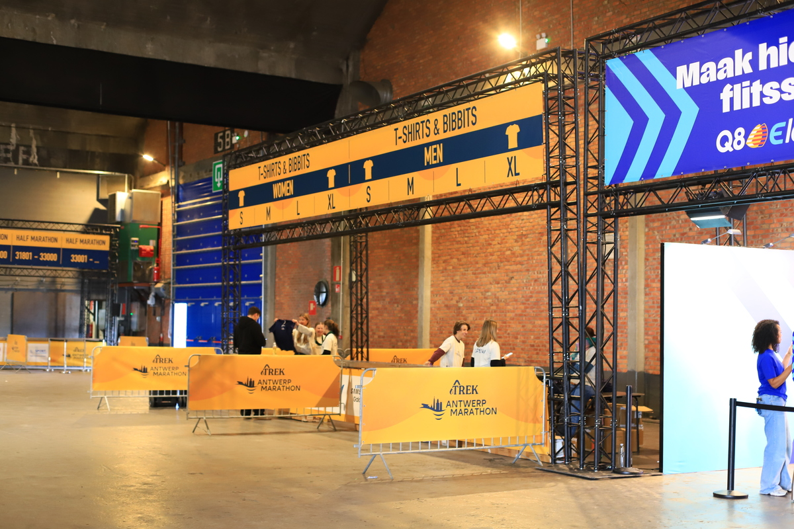
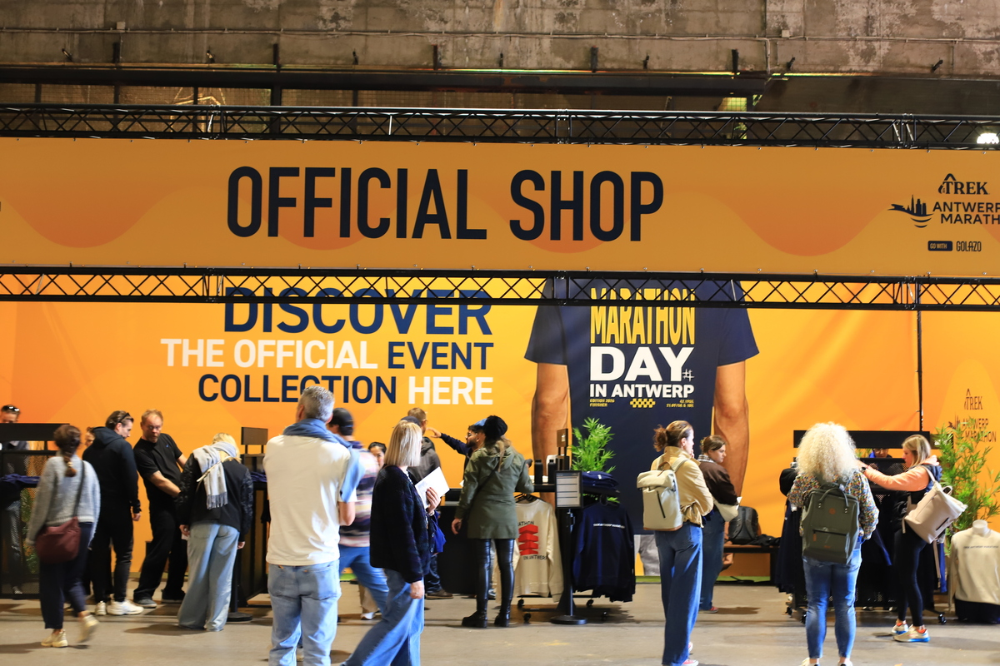
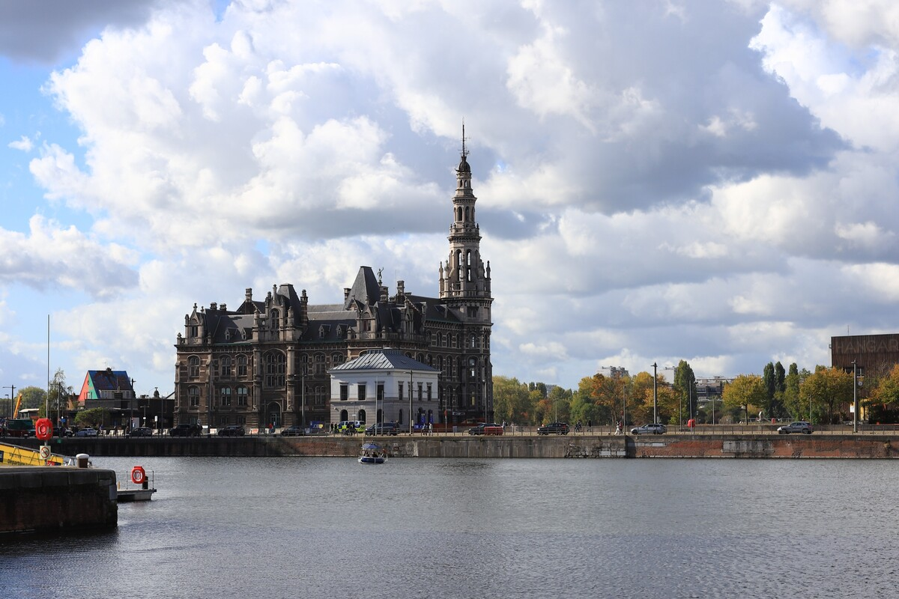
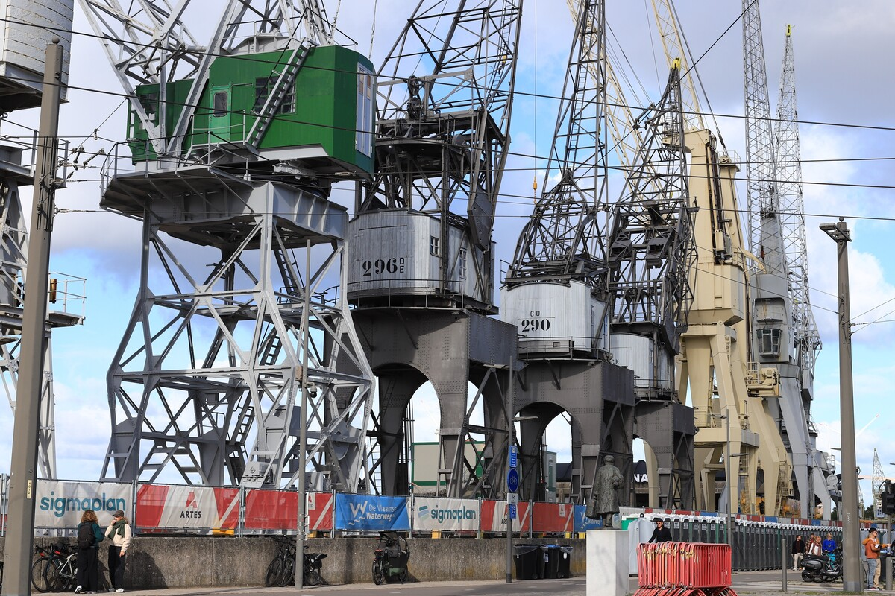
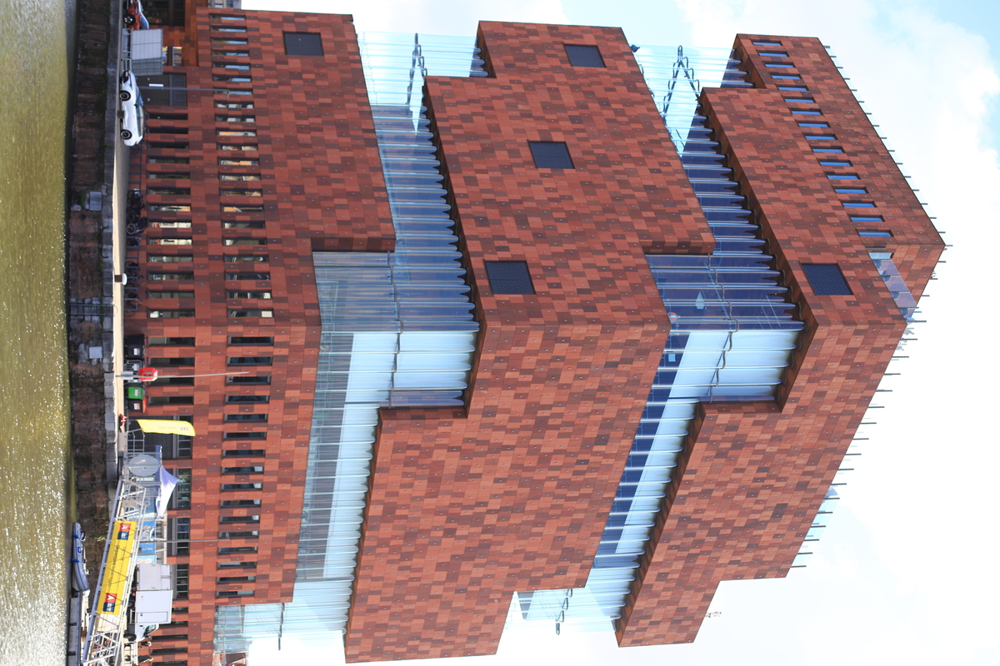
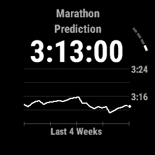
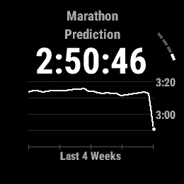

## La préparation

Toujours intéressant de revenir sur une prépa, qu'elle ait fonctionné ou pas. Pour la résumer en un mot, je dirais: 
> simplicité.

L'idée était d'éviter tout ce qui pourrait poser problème (jambes lourdes, digestion etc). Pas d'optimiser et de jouer avec les limites.

- Entrainements: beaucoup de volume, quasi pas de VMA, du seuil pour les séances de qualité, et quelques sorties longues, mais rien de vraiment régulier.
- Affutage: juste réduit le gros volume, sans que ce soit brutal.
- Alimentation avant course: les jours où je n'allais pas courir, j'essayais de manger moins; à partir du jeudi, reprise des glucides lents, mais pareil: sans exagérer, surtout pas la veille de la course. 
- Repos: la dernière semaine j'ai essayé (et réussi) à avoir des nuits de sommeil tout à fait correct, en pensant que la dernière nuit je n'arriverais pas à dormir (finalement si j'ai pu dormir très très bien).
- Alimentation en course: 4 gels 226ers High Energy, prévus au KM 8, 16, 24 et 32; de l'eau comme unique source d'hydratation.

Un autre point de vue sur la prépa, pour reprendre une expression d'un de mes profs d'unif:
> Tuer une mouche avec un bazooka

Courir 130 km par semaine pendant plusieurs semaines, était-ce bien nécessaire? Pour moi oui, je l'expliquerai plus tard.

## Le parcours

Ce qu'il faut retenir du parcours: deux fois la même boucle, plutôt qu'un parcours simple. Est-ce bien ou pas? Personnelement ça m'a plu, d'une certaine façon on sait à quoi s'attendre au 2° tour, en revanche, s'il y a un obstacle tel qu'une grosse montée, ça peut faire mal au moral.

Aussi j'ai trouvé qu'il y avait pas mal de pavés: ça n'a pas posé problème, mais par endroit c'était marrant de voir les coureurs se mettre de part et d'autre de la chaussée, en laissant le milieu (pavé) totalement vide. 



## Déroulement de la course

### Les premiers km

Je m'étais mis dans le sas `02:59 - 03:14`, car le sas plus rapide me semblait un tantinet trop ambitieux. D'ailleurs après l'échauffement j'avais même reculé afin de ne pas être dans les premiers du sas. Dès le départ j'essaie de trouver l'allure cicle: du `4'10/km`, même si ça n'a pas été facile: je regardais souvent la montre, parfois elle indiquait du `4'25/km`, d'autres fois du `3'35/km`, pas facile de savoir à quoi s'en tenir. La solution: suivre les deux meneurs d'allure qui devaient nous emmener vers le `2:59`.

Dès le début je dis que cette allure, elle est facile, et que la tenir 3 heures ça ira.

### 10°km: premier (et dernier) soucis

Les kilomètres défilent, je reste dans le groupe des marqueurs d'allure et profite de la course. Dans l'arrière de mon short, les 3 gels commencent à balancer fort et ça m'ennuie. OK c'est débile, mais le noeud du cordon du short s'est défait, et le short commence à descendre. J'arrive finalement à règler ça et ressens un tout grande soulagement, comme si je me sentais plus léger. Petit à petit je m'approche de la tête de notre groupe, mais hésite à partir. J'ai envie de faire ma course, sur mon rythme, il faut juste choisir le bon moment.

### 15°km: je m'en vais

Je ne sais pas ce qui a provoqué ça, en tout cas j'ai senti que c'était le bon moment de me séparer du groupe. Dans ma tête: 15 km on est proche de la moitié de course, et une fois à la moitié, ça ira encore mieux. Aucune idée pourquoi je pensais ça! Comme si le fait de recommencer la même boucle allait faciliter la course.

### 20°km: la début de la fin

Vers le 20° on fait une sale boucle dans le port, un tronçon qu'on dirait qu'ils ont mis juste pour ajouter 1 ou 2 kilomètres, mais qui n'a pas vraiment de sens. À ce moment on croise les coureurs qui sont devant, puis après le demi-tour, ceux qui sont derrière. C'est là que je me rends compte de la taille du groupe des meneurs d'allures: rien qu'au bruit des foulées, on sent qu'ils sont un bon paquet. Raison de plus pour ne pas y retourner. Une fois cette boucle terminée on va retourner vers la civilisation, c'est-à-dire dans une zone avec des spectateurs. Mentalement ça fait du bien.

### 25°km: rien ne peut arriver

Les jambes tournent toujours bien, juste une douleur (niveau 2/10) à un mollet, seul truc qui me fait un peu peur. Les gels passent bien, et j'arrive même à boire proprement les goblets d'eau. Je ne sais pas si c'est juste une sensation, mais j'ai l'impression d'accélérer un petit coup. J'ai tellement lu et entendu parler du mur du 30° km que j'ai hâte d'y arriver, parce que je ne pense vraiment pas que ça va m'arriver.

### 30°km: il ne se passe rien

Vers le 30° je commence à calculer, sans pour autant regarder mon chrono: j'ai juste regarder l'allure, mais aucune idée du temps écoulé. S'il reste 12 km, ça veut dire normalement moins d'une heure. Facile. Je suis parfois tout seul, parfois dans des petits groupes. 31, 32, 33... les kilomètres passent rapidement, 34, je me dis qu'il ne reste que 8 km, rien du tout, une petite sortie normale. 

### 35°km: un peu dans le dur

À ce moment-là je commence à comprendre que le corps accuse un peu le coup, en particulier les muscles autour du cou. Quelques mouvements de la tête et ça soulage. En théorie ça devrait tenir. L'ambiance est top et je dépasse pas mal. On commence à voir des blessures et des abandons. Des gars qui étaient bien quelques km auparavant.

J'essaie d'accélérer encore un coup, mais sans exagérer, je veux la jouer _safe_: sub-3 est l'objectif, je ne veux pas prendre le risque d'exploser sur la fin.

### 40°km

Plus le temps passe et plus je calcule. J'ai toujours été conscient que c'est un signe de fatigue en course. 2 kilomètres, ça fait moins de 10 minutes, ça ira, surtout que les derniers km sont vraiment plein de gens. 41°km: il reste 1200 mètres, c'est facile un 1200. On voit la ligne au loins, reste plus qu'à profiter. Je n'ai toujours pas regardé le temps sur la montre mais comme je suis assez devant les meneurs d'allure, pas de soucis à me faire.

Je passe la ligne, soulagement, une bonne chose de faite comme on dit souvent. 

## Réflexions post-course

Une chose assez drôle quand on se met en tête certains défis, c'est qu'on pense que les choses seront différentes une fois que ce sera fait. Par exemple après la TransGranCanaria, j'étais sûr que je serais différent, que je verrais les choses différement etc. Mais non, en fait ça ne change absolument rien, et c'est pareil pour le marathon sous les 3 heures. Je me disais que ça me ferait quelque chose d'y arriver, et puis une fois que c'est fait, on se rend compte que la vie continue, qu'on reste au coureur ordinaire, et surtout qu'il y encore moyen de faire mieux.

### Clin d'oeil à ma montre

La plupart des montres ont des algorithmes pour estimer les temps qu'on fera sur des distances typiques: 5K, 10K, semi, ... Je regarde ça de temps en temps et la semaine de la course elle m'indiquait un temps plutôt _bof_. Après la course j'ai revérifié et il semble que l'algorithme ait corrigé son tir. 

| |  |

### Objectifs atteints?

Si on se centre uniquement sur le temps, la réponse est oui. Parallèlement à ça, j'avais aussi un objectif moins visible: j'avais envie de normaliser le marathon, c'est-à-dire d'en terminer un sans que je me dise que c'était trop dur, sans devoir aller trop loin dans l'effort et dans la douleur. Juste que ce soit dur, parce que long, mais pas que ce soit assimilé à une punition ou un truc qu'on ne voudra plus jamais faire.

D'où les semaines à 130 km. C'est sûr, avec 80 km il doit être possible de faire un sub-3 aussi, en optimisant la préparation, le poids, etc, mais je n'avais pas envie de ça. Juste envie de courir (beaucoup), jusqu'à ce que des trucs qui avant me paraissaient très difficiles, deviennent finalement accessibles. 

### Prochaine étape?

Aucune, c'est justement ça la conclusion. La course est faite, il faut retourner au bureau, s'occuper de la famille, terminer de peindre le plafond de la salle de bain, mettre les pneus hiver.

